<p align="center">
  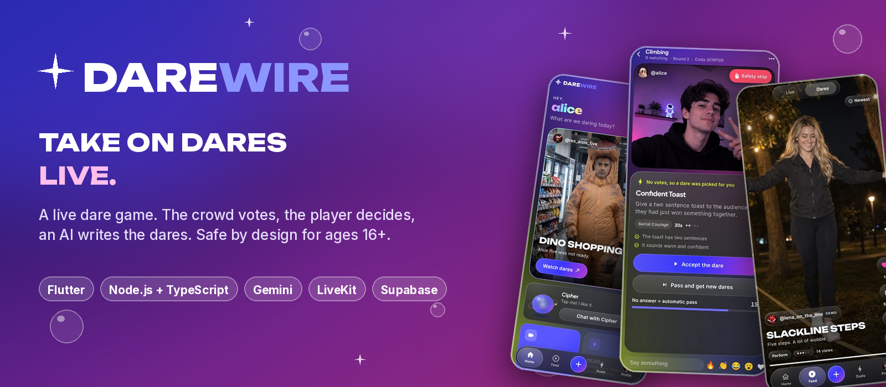
</p>

# DAREWIRE

**A live dare game for ages 16 and over**
Flutter app (Android · iOS · web) · Node.js + TypeScript server · Gemini AI · LiveKit video · Supabase
*Take on dares live. Let the crowd decide.*


[](https://github.com/javohir-io/darewire/actions/workflows/ci.yml)


> A real-life take on the idea behind the film *Nerve*, with the dangerous parts designed out: an AI writes the dares, the crowd votes, the player can pass for free or hit **Safety Stop** at any moment, and teens (16 to 17) are kept apart from adults and held to a stricter content floor. Built end to end as a portfolio project.

## Overview

One player goes live on camera. An AI **Director** writes five dares, the audience votes, and the player accepts or passes. Midway through, the crowd can vote on a surprise **twist**. When the round ends the audience judges, and the server scores it. Between rounds there are duels, quests, a daily streak, a leaderboard, following, chat, and **Cipher**, an AI companion.

## Features

**The game**

- Live sessions with a server-authoritative state machine: lobby, ready check, dare generation, **crowd vote**, player review, live round, verdict, result
- **AI Director** (Gemini): five dares per round, with the output treated as untrusted: parsed, policy-checked, de-duplicated, reviewed by a second independent model call, and topped up from an approved fallback library, so the game still works if the AI is down
- **Twist rounds:** the crowd votes on a surprise modifier from an approved template list (the AI never writes twists)
- **Safety Stop** from any phase ends the turn at once with no penalty; **Pass** is always free
- Live video through LiveKit with room-scoped tokens; only the player can publish

**Social**

- **Duels:** challenge a person with a curated or custom dare, 48 hours to accept, points for both when completed
- **Follow** people, a **Following** tab in the Dares feed, **Discover** with search and suggestions
- **Messages:** inbox, message requests and chat threads, with a message filter and reporting that sends the last messages to moderators
- **Activity** page (new followers, likes, requests), blocking, a **Safety centre**
- **Rewards:** points ledger with unique keys and daily caps, daily quests, a streak, a 30-day leaderboard (points are status only, never cash)

**Built for ages 16+**

- Two age bands (**teen** 16 to 17, **adult** 18+) derived from the date of birth on every request. Teens and adults never share a live session, duel, search, feed, follow or chat
- Teen accounts get a content floor on every dare (level 3 at most, no romance, dark humor or approaching strangers, extra word rules) and can only chat with **mutual followers**
- The age answer is **write-once**, so a 16-year-old cannot simply re-enter an adult birthday, and a too-young answer is remembered
- Details and the full table below

**Design**

- **Liquid-glass** UI with a live backdrop (drifting colour fields, glossy bubbles, sparkles), a looping video hero, a floating glass tab bar, four themes, and a wide futuristic display type
- **Smooth mode** (blur and animation off) switches on by itself on slower phones; see [`docs/design-system.md`](docs/design-system.md)

## Screenshots

<table>
<tr>
<td align="center"><b>Welcome</b></td>
<td align="center"><b>Birthday screen</b></td>
<td align="center"><b>Home</b></td>
</tr>
<tr>
<td align="center">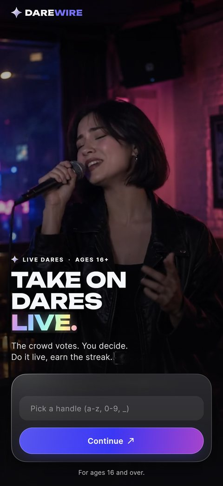</td>
<td align="center">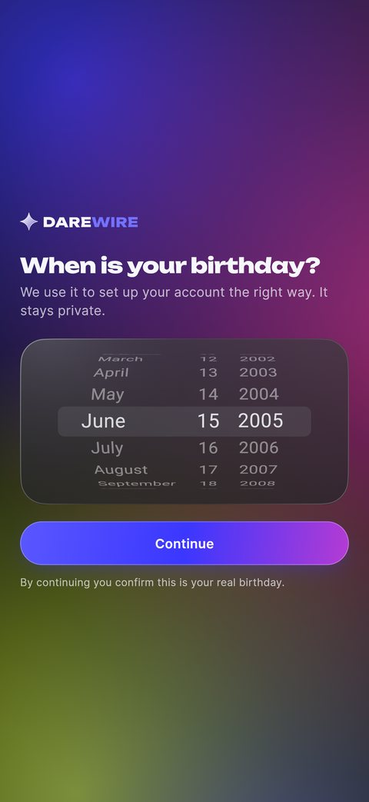</td>
<td align="center">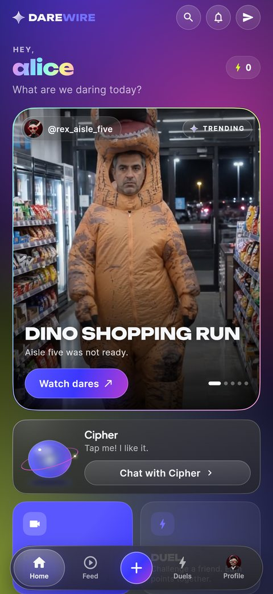</td>
</tr>
</table>

<table>
<tr>
<td align="center"><b>Home, further down</b></td>
<td align="center"><b>Dares feed</b></td>
<td align="center"><b>Live round</b></td>
</tr>
<tr>
<td align="center">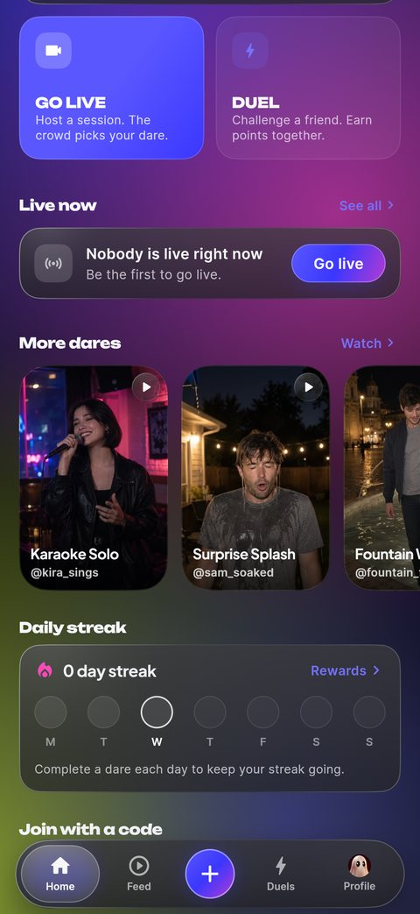</td>
<td align="center">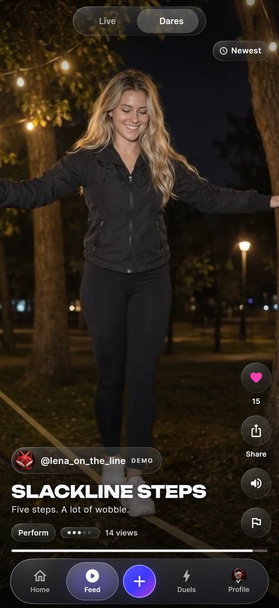</td>
<td align="center">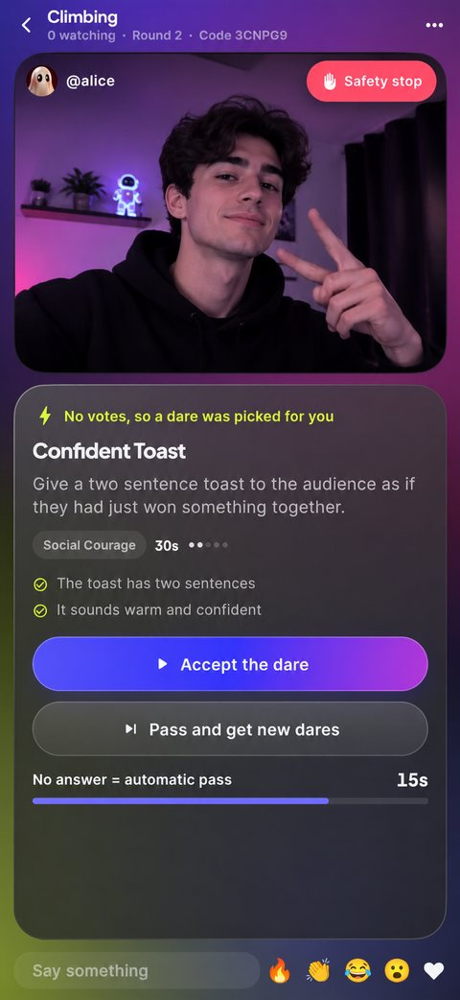</td>
</tr>
</table>

<table>
<tr>
<td align="center"><b>Round complete</b></td>
<td align="center"><b>Cipher, the AI companion</b></td>
<td align="center"><b>Duels</b></td>
</tr>
<tr>
<td align="center">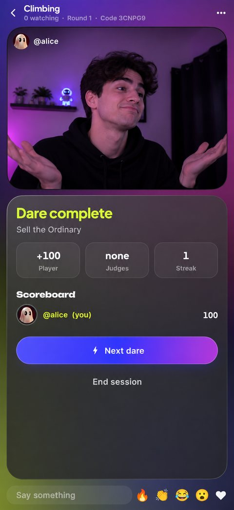</td>
<td align="center">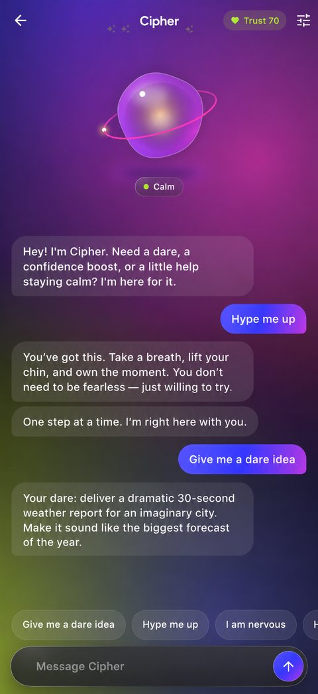</td>
<td align="center">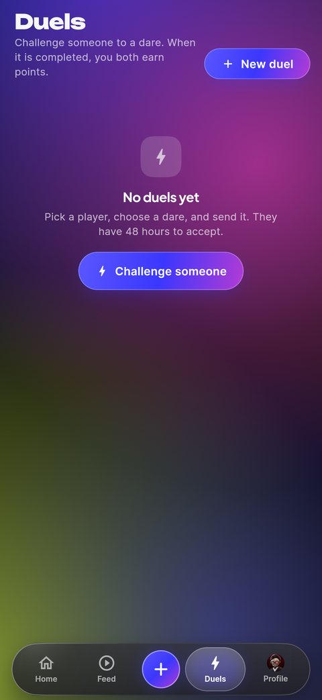</td>
</tr>
</table>

<table>
<tr>
<td align="center"><b>Rewards</b></td>
<td align="center"><b>Profile</b></td>
<td align="center"><b>Settings</b></td>
</tr>
<tr>
<td align="center">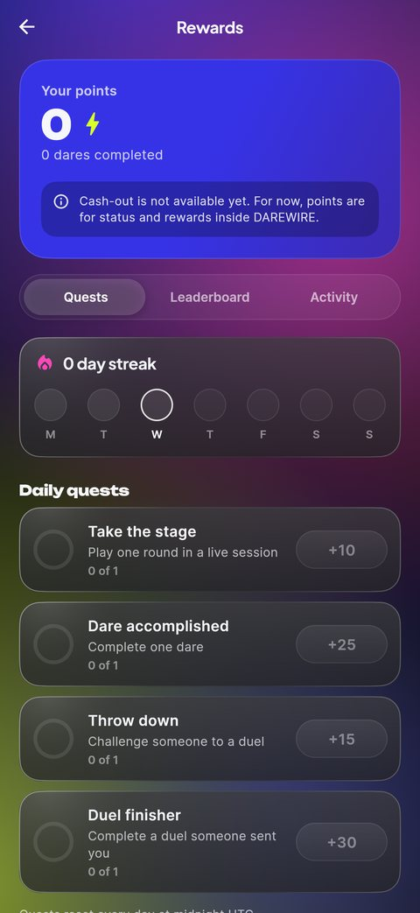</td>
<td align="center">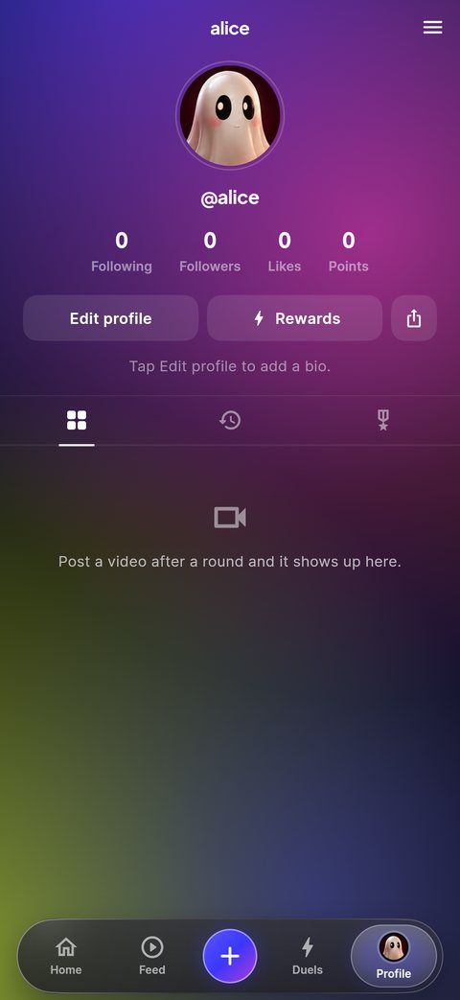</td>
<td align="center">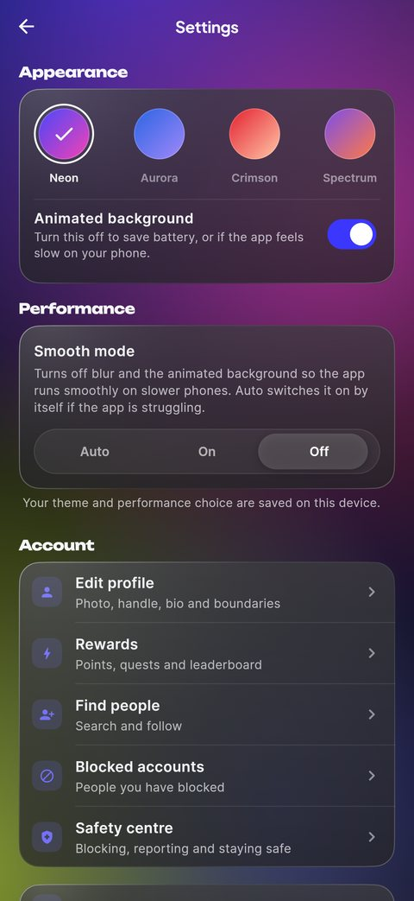</td>
</tr>
</table>

## Architecture

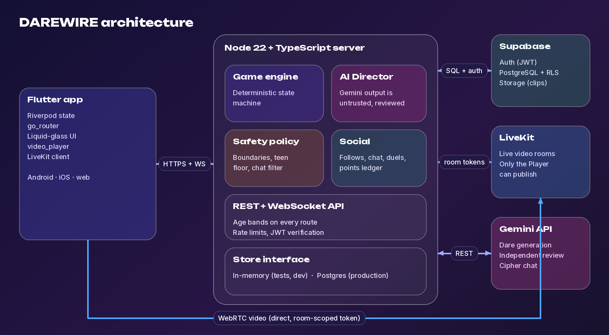

| Layer | Tech | Where |
|---|---|---|
| Mobile app | **Flutter** (Dart 3), Riverpod, go_router, flutter_animate, custom painters (backdrop, glass, Cipher), video_player, LiveKit client | [`mobile/`](mobile) |
| Backend | **Node 22 + TypeScript** (no build step), Express, `ws`, `jose` | [`server/`](server) |
| Game rules | Deterministic state machine, injected clock, zero dependencies | [`server/src/engine`](server/src/engine) |
| AI | **Google Gemini** over REST, structured output, key stays on the server | [`server/src/director`](server/src/director) |
| Safety | Schema + context-aware policy + boundary enforcement + independent model review + fallbacks, age bands, chat filter | [`server/src/policy`](server/src/policy), [`server/src/profile`](server/src/profile), [`server/src/social`](server/src/social) |
| Duels, quests, points, chat | Server-side rules, a unique-key points ledger, daily caps | [`server/src/social`](server/src/social) |
| Data + auth | **Supabase** (Auth + PostgreSQL), RLS deny-by-default | [`supabase/`](supabase) |
| Live video | **LiveKit**, server-issued room-scoped tokens | [`server/src/media`](server/src/media) |

**Notable decisions**

- **The server decides everything that matters.** Votes, timers, scoring, ages, who can reach whom and what a dare may say are all enforced on the server. The app only mirrors it.
- **AI output is untrusted input.** It is parsed, checked against policy, reviewed by a second model call and backed by fallbacks. The AI never writes twists and never decides a score.
- **One age rule, applied everywhere.** A single `sameBand` check gates sessions, duels, search, follows, chat, the feed and profiles. Another band answers exactly like "this does not exist", so nothing leaks.
- **Teen chat is mutual-follow only,** re-checked on every message, so unfollowing closes the conversation.
- **A deterministic engine with an injected clock** is what makes 100 simulated voters at once testable on a laptop.
- **Store interface:** the same rules run against an in-memory store (tests and dev) or Postgres.
- **Performance is a feature:** blur is used only for a few large panels; the app measures its own frame times and enables Smooth mode automatically.

## Ages and teen safety

The minimum age is **16** (one constant, `MIN_AGE` in [`server/src/profile/age.ts`](server/src/profile/age.ts)). Everything below is enforced by the server.

| | Teen (16-17) | Adult (18+) |
|---|---|---|
| Live sessions, join by code | Teen sessions only | Adult sessions only |
| Follow | Other teens only | Other adults only |
| Direct messages | Only **mutual followers**; links, numbers, meet-up and personal-question talk blocked | Mutual followers, or **one message request** the other person accepts or declines; links and contact details blocked |
| Duels, user search | Other teens only; teens pick from dare ideas (no free text) | Other adults only; custom dares allowed |
| Profiles, leaderboard, Dares feed | Other teens' (plus the demo clips) | Other adults' (plus the demo clips) |
| Dares | Level 3 maximum, no romance, dark humor or approaching strangers, plus extra word rules | The player's own boundaries |
| Cipher (AI companion) | PG persona, takes pressure and secrets seriously, nudges sleep late at night | Standard persona |

Moderators and admins can see both bands. Age is **self-declared**, not verified; read [`docs/threat-model.md`](docs/threat-model.md) for what a public launch would still need.

## How a round works

```
LOBBY → READY_CHECK → CHALLENGE_GENERATION → CHALLENGE_VOTE → PLAYER_REVIEW → LIVE_ROUND
      → SUBMISSION → AUDIENCE_VERDICT → ROUND_RESULT → (next round | LOBBY | SESSION_END)
```

1. The player confirms their **boundaries** (categories, themes, difficulty cap). The server enforces them on every dare.
2. The **Director** asks Gemini for candidates, then validates, reviews and tops them up with approved fallbacks.
3. The audience gets **one vote** on five dares. The server locks the vote on its own timer, picks the winner and breaks ties deterministically.
4. The player can **accept or pass**. At any point a **Safety Stop** ends their turn with no penalty.
5. Mid-round, **the twist**: the crowd votes on a surprise modifier.
6. The audience judges the attempt; the server scores it.

Full rules: [`docs/game-rules.md`](docs/game-rules.md).

## Getting started

**Requirements:** Node 22.18 or newer, Flutter 3.47 or newer. No accounts or keys are needed to try it.

```bash
# 1. Backend (in-memory store, development login, demo dare videos)
cd server
npm install
cp .env.example .env        # optional
npm test                    # 93 tests
npm start                   # http://localhost:3000

# 2. App (new terminal)
cd mobile
./setup.sh                  # Windows: ./setup.ps1  (creates the platform folders, fetches packages)
cp env.example.json env.json   # Windows: copy env.example.json env.json
# then set API_URL in env.json: http://localhost:3000 (Chrome / iOS simulator),
#                http://10.0.2.2:3000 (Android emulator), or your computer's LAN IP (real phone)
flutter run --dart-define-from-file=env.json
```

Without Supabase the app shows a clearly labelled **development login**. Add keys to `server/.env` to switch on the real services: `GEMINI_API_KEY`, `LIVEKIT_*`, `DATABASE_URL` and `SUPABASE_*`. Step by step: [`docs/setup.md`](docs/setup.md).

**Judging speed:** use `flutter run --profile` (or `--release`) on a real phone. Debug mode and Chrome are much slower than the real app. In VS Code, pick *"phone or emulator (profile)"* in Run and Debug.

Prove the concurrency claims on your own machine (100 simulated viewers voting at once):

```bash
cd server && npm run simulate -- 100
```

## Tests

```bash
cd server && npm test                          # 93 tests: engine, policy, age bands, chat, follows, HTTP, realtime
cd mobile && flutter analyze && flutter test   # models, age helpers, theme contrast
```

Both run in GitHub Actions on every push.

## Status

| Part | State |
|---|---|
| `server/` | 93 automated tests, strict TypeScript, runs against an in-memory store |
| Game engine | Exercised against votes arriving late, twice and concurrently, tie-breaks, Safety Stop from every phase, reconnects and server restarts |
| `mobile/` | Type-checked against Flutter 3.47 and run in a browser; client unit tests for models and age logic. No automated UI tests, and not yet tested on a range of real devices |
| Postgres store and migrations | Written to match the in-memory store that the tests cover, but **not yet run against a live database in development** |
| Deployment | Not deployed |

**Known limitations:** age is self-declared and the app has had no legal or child-safety review (do not run it for real minors without one); chat arrives by polling (no push or WebSocket chat); the safety lexicons are English-only, and a filter reduces risk but does not remove it, which is why Safety Stop, Pass, block and report exist; the demo clips in `server/public/demo` are AI-generated placeholders labelled DEMO; points can never be cashed out.

**Roadmap:** run the Postgres store against a live project and add it to CI, real-time chat over WebSocket, push notifications, video comments, verified age assurance, deployment.

## Documentation

| | |
|---|---|
| [`docs/architecture.md`](docs/architecture.md) | How the pieces fit together |
| [`docs/game-rules.md`](docs/game-rules.md) | Phases, voting, scoring, teen sessions |
| [`docs/api.md`](docs/api.md) | Every HTTP route and the WebSocket protocol |
| [`docs/threat-model.md`](docs/threat-model.md) | Risks, controls and what is still open |
| [`docs/design-system.md`](docs/design-system.md) | Liquid-glass design, motion, performance |
| [`docs/setup.md`](docs/setup.md) | Keys and services, step by step |
| [`docs/points-and-rewards.md`](docs/points-and-rewards.md) | Points ledger and why there is no cash-out |
| [`CHANGES.md`](CHANGES.md) | What changed, release by release |

## Repo map

```
mobile/    Flutter app: lib/{core,data,state,gfx,ui}, assets/ (icon, 12 avatars, demo posters), tool/
server/    src/{engine,policy,profile,director,realtime,http,store,media,social}, test/, tools/simulate.ts, public/demo
supabase/  migrations/0001..0008 (schema, votes, RLS, profile extras, social, avatars, age 16+, follows/chat/activity)
docs/      architecture, rules, API, threat model, setup, design system, points, ADRs, screenshots, images
```

## License

[MIT](LICENSE) © 2026 Javohir Abduvahhobov. The demo clips are AI-generated placeholders; the avatars are bundled assets for this project. Fonts are loaded from Google Fonts (SIL Open Font License).
